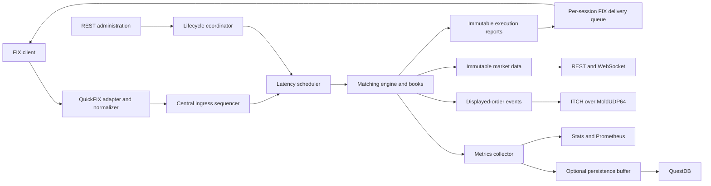

# Architecture

MockX is a deterministic exchange simulator for strategy tests. Its public trading boundary is FIX 4.4; REST controls the simulation and inspects state, while WebSocket and optional ITCH/GLIMPSE services distribute market data. Start with [Getting Started](https://github.com/lehajamb/mockx/wiki/Getting-Started) for a runnable walkthrough.

## Component ownership

`MockExchange` constructs and retains the components. `ExchangeLifecycle` owns one asynchronous lock that serializes startup/shutdown, simulation start/end, scheduler advancement, run reset, and committed FIX ingress.

GLIMPSE adds atomic resting-order snapshots and bounded interrupted-spin recovery alongside the ITCH feed. It reads the authoritative book and captures a matching feed sequence boundary; it is not a second matching engine.

| Component | Responsibility | Main source |
|---|---|---|
| `MockExchange` | Wiring, callbacks, process startup/shutdown | `main.py` |
| `ExchangeLifecycle` | Run transitions, generation identity, serialized mutations | `lifecycle.py` |
| `FIXApplication`, `SessionRegistry` | FIX validation, stable session identity, participant ownership, ingress | `gateway.py` |
| `LatencyScheduler` | Simulated clock, ordered events, failure diagnostics | `latency.py` |
| `MatchingEngine`, `OrderBook` | Exact matching, quantity accounting, cancellation/replacement | `engine.py`, `models.py` |
| `OutboundFixDeliveryQueue` | Immutable application records and per-session retry order | `delivery.py` |
| `ExchangeAPI` | FastAPI routes, readiness, book UI, WebSocket subscriptions | `api.py` |
| `MetricsCollector`, `BufferedMetricsWriter` | Scoped measurements, bounded persistence, run integrity | `metrics.py` |
| Feed publishers and transports | ITCH encoding, multicast, GLIMPSE/SoupBinTCP | `itch_delivery.py`, `glimpse_service.py` |

The retained API is available as `exchange.api`, and the FastAPI app as `exchange.app`. App state exposes the same owned engine, scheduler, metrics, and session registry. Tests do not need to recover these objects by inspecting route closures.

## Startup and shutdown

Construction validates configuration without starting external traffic. FastAPI lifespan startup keeps readiness false while it:

1. Starts enabled persistence and its health check/background writer.
2. Captures the asyncio loop and hands it to the QuickFIX adapter.
3. Confirms engine callback registration and binds the optional GLIMPSE listener.
4. Starts the FIX acceptor and optional realtime clock task.
5. Enables administration and marks startup complete.

`/readyz` still evaluates component, lifecycle, and required persistence health after startup. `/healthz` only answers whether the process is alive.

Shutdown disables readiness/administration, stops new GLIMPSE connections and active spins, stops FIX and the realtime task, closes the ITCH run, stops the scheduler and WebSockets, then flushes/closes persistence. It clears adapter loop references and is idempotent. Persistence close failure is recorded with its unflushed count; remaining teardown still proceeds.

## Two clocks

| Clock | Purpose | Units and behavior |
|---|---|---|
| Simulated UTC | Event order, fill/report timestamps, configured transport and engine latency | Scheduler timestamps; configured delays in milliseconds |
| Real monotonic time | Measured computation duration, persistence retry deadlines and buffered-record age | CPU measurements in microseconds; independent of simulation advancement |

The default external clock moves only when explicitly advanced. Realtime mode uses an asyncio task, so its relationship to machine scheduling is not deterministic even though equal-time event ordering is. See [Sessions and Simulated Time](https://github.com/lehajamb/mockx/wiki/Sessions-and-Simulated-Time).

## Ownership and identity boundaries

Each order belongs to a configured participant and stable QuickFIX `SessionID`. A display alias is not an ownership credential. Several sessions can belong to one participant; self-trade prevention applies across those sessions.

Public order, execution, and trade IDs include the run generation. Successful start resets run-local books, counters, scheduling state, and random seed. It also closes old WebSockets and starts a fresh feed generation. Process-lifetime FIX delivery backlog and stable-session `ClOrdID` duplicate history survive these run resets. A transport disconnect replaces no business identity.

This separation prevents a delayed report from an earlier run from being mistaken for a new run's order. It does not provide durable application recovery after a process restart.

## Failure boundaries

| Failure | Result |
|---|---|
| Unexpected scheduler handler failure | Scheduler becomes `FAILED`; the dead-lettered event is not retried, later events stay queued, and time cannot advance |
| Permanent metric admission loss | The current engine command finishes; lifecycle becomes `RUN_FAILED`, blocks further trading, and permits delivery/feed servicing |
| Transient QuestDB write failure with every row retained | Persistence retries; run integrity remains complete, but enabled unhealthy persistence prevents traffic readiness |
| FIX transport failure | The stable session retains its immutable delivery head and retries; other sessions can progress |
| ITCH runtime failure | Feed degrades for that generation; an otherwise healthy matching run remains active |
| Destructive session-reset failure | Lifecycle becomes `FAILED`; process restart is required |

An unexpected engine/scheduler exception is not transactionally rolled back. Inspect the failed run and rerun inputs after recovery; do not replay an arbitrary dead-lettered command against partially changed state.

## Further reading and sources

- [Matching Engine and Scheduler](https://github.com/lehajamb/mockx/wiki/Matching-Engine-and-Scheduler)
- [Metrics and Persistence](https://github.com/lehajamb/mockx/wiki/Metrics-and-Persistence)
- [Interactive system architecture](https://lehajamb.github.io/mockx/mockx-architecture.html)
- Pinned implementation: [application ownership](https://github.com/lehajamb/mockx/blob/556e28b533171ceee63864e396faedfb2ef7aa8e/src/mockx/main.py), [lifecycle](https://github.com/lehajamb/mockx/blob/556e28b533171ceee63864e396faedfb2ef7aa8e/src/mockx/lifecycle.py), [architecture guide](https://github.com/lehajamb/mockx/blob/556e28b533171ceee63864e396faedfb2ef7aa8e/doc/mockx-architecture.html).
