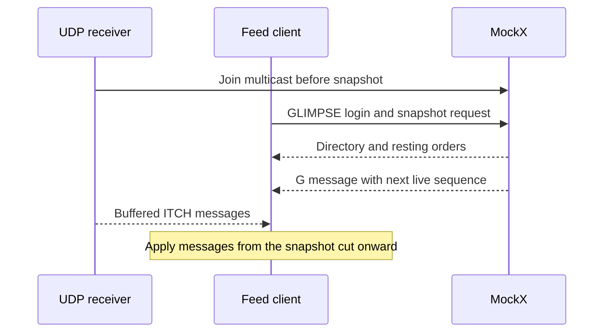

# C++ Market Feed Client

`mockx_market_feed` is a C++20 client for MockX's GLIMPSE 5.0 snapshots and TotalView-ITCH 5.0 updates. It retains every resting order and displays an aggregated top-N book. It has no third-party C++ package dependency; running against an exchange still requires a working MockX process or Docker demo.

Prices stay integer ITCH Price(4) values (four decimal places). Quantities are integer ITCH shares, mapped by MockX one-to-one to instrument lots. For a `0.001` lot size, 1,000 displayed shares represent `1.000` instrument units.

## Build and test

Use CMake 3.20 or newer and a C++20 compiler. On Windows, open an x64 Visual Studio developer prompt and run these commands from the repository root:

```powershell
cmake -S examples/cpp_market_feed -B examples/cpp_market_feed/build
cmake --build examples/cpp_market_feed/build --config Release
ctest --test-dir examples/cpp_market_feed/build -C Release --output-on-failure
```

On Linux with GCC or Clang:

```bash
cmake -S examples/cpp_market_feed -B examples/cpp_market_feed/build -DCMAKE_BUILD_TYPE=Release
cmake --build examples/cpp_market_feed/build --parallel
ctest --test-dir examples/cpp_market_feed/build --output-on-failure
```

Normal CTest tests do not require Python or a running exchange. On Linux, configure with `-DMOCKX_FEED_ENABLE_SANITIZERS=ON` for AddressSanitizer and UndefinedBehaviorSanitizer. An optional `-DMOCKX_FEED_ENABLE_LIVE_TEST=ON` adds a test that starts MockX, completes GLIMPSE, applies a later update, and verifies clean run termination; configure from the installed MockX Python environment when using it.

## Prepare an exchange

The [Docker live demo](https://github.com/lehajamb/mockx/wiki/Docker-and-Live-Demo) already enables both feeds, starts a simulation, and supplies the host UDP relay. Use that path for a changing book without manual order submission. Do not issue a second session-start request while its driver owns the run.

For a standalone local exchange, merge the following settings into the local YAML, preserving its instrument, FIX participant, and API settings:

```yaml
itch:
  enabled: true
  market_category: " "
  financial_status: " "
  round_lot_size: 1
moldudp64:
  multicast_group: 239.192.0.1
  multicast_port: 18000
  session_prefix: MX
  heartbeat_interval_ms: 1000
  max_payload_bytes: 1400
  interface_address: 0.0.0.0
  ttl: 1
glimpse:
  enabled: true
soupbintcp:
  host: 127.0.0.1
  port: 18001
  session_prefix: GS
  credentials:
    GLIMP: CHANGE_ME
  login_timeout_ms: 30000
  write_timeout_ms: 5000
  max_connections: 64
  replay_ttl_ms: 60000
  max_cached_sessions: 32
  max_cached_bytes: 67108864
```

`CHANGE_ME` is the checked-in development credential. Match the client password to the exchange configuration. Follow [Getting Started](https://github.com/lehajamb/mockx/wiki/Getting-Started) to start the server using the edited YAML, then start a simulation before connecting the feed client:

```bash
curl -f -X POST http://127.0.0.1:8001/api/v1/session/start \
  -H 'Content-Type: application/json' -d '{"run_id":"cpp-feed-demo"}'
```

```powershell
Invoke-RestMethod -Method Post -Uri http://127.0.0.1:8001/api/v1/session/start -ContentType 'application/json' -Body '{"run_id":"cpp-feed-demo"}'
```

A fresh local session has an empty book. Submit liquidity through FIX and advance time in external mode to obtain later updates and scheduled heartbeats.

## Connect

Set the password through the environment, then run the client. This avoids placing it in the client's command-line arguments.

```powershell
$env:MOCKX_GLIMPSE_PASSWORD = "CHANGE_ME"
examples\cpp_market_feed\build\Release\mockx_market_feed.exe --symbol BTC-USDT
```

```bash
export MOCKX_GLIMPSE_PASSWORD=CHANGE_ME
examples/cpp_market_feed/build/mockx_market_feed --symbol BTC-USDT
```

The defaults match the local/root Docker fixture:

| Option | Default / purpose |
|---|---|
| `--itch-group` | `239.192.0.1` |
| `--itch-port` | `18000` |
| `--interface` | `0.0.0.0`; select a local IPv4 multicast interface when needed |
| `--glimpse-host` | `127.0.0.1` |
| `--glimpse-port` | `18001` |
| `--symbol` | Repeat for multiple symbols; omit to display all instruments |
| `--datagram-bytes` | `2048`; must be at least the exchange's `moldudp64.max_payload_bytes` |

Run the built executable with `--help` for username, ring, display, and recovery options. Socket setup, authentication, and protocol/recovery failures have nonzero exit codes. Mold end-of-session, ITCH End of Messages, and Ctrl+C are normal zero-exit outcomes.

## Snapshot and live-update sequence



The client joins multicast first, buffers datagrams, obtains the atomic snapshot, and applies updates beginning at the sequence in GLIMPSE's `G` message. This closes the race between taking a snapshot and receiving subsequent changes.

The UDP receiver writes directly into reserved fixed ring slots. A book thread validates lengths and decodes big-endian fields without unaligned native loads; a separate display thread handles console output. The ingress queue is a bounded single-producer/single-consumer ring with lock-free 64-bit indices. Console output uses a separate best-effort ring.

Ring saturation, truncated packets, malformed input, and forward sequence gaps invalidate continuity and trigger a new GLIMPSE cut. The client does not knowingly continue with a stale book and does not implement Mold retransmission requests.

## Supported updates and replacements

The client applies book-changing `A`, `E`, `C`, `D`, and `X`, and consumes `R`, `H`, `S`, and GLIMPSE-only `G`. Unsupported message types are hard errors; silently skipping a future book-changing type would invalidate the display.

Native FIX replacement can retain an order's FIX `OrderID` while changing its displayed ITCH reference:

| Amendment | Feed behavior |
|---|---|
| Same-price quantity reduction | `X` removes shares while preserving reference and FIFO. Zero remaining shares remove the order. |
| Price change or quantity increase | Old-reference `D`, passive `E/C` for new executions, and a fresh-reference `A` if a remainder rests. |
| No-op or rejected replacement | No book update. |

The client rejects reductions referencing unknown orders, zero reductions, and reductions exceeding leaves. GLIMPSE carries current displayed references, allowing recovery to reconstruct the same FIFO book.

Sources: [native client guide](https://github.com/lehajamb/mockx/blob/556e28b533171ceee63864e396faedfb2ef7aa8e/examples/cpp_market_feed/README.md), [build configuration](https://github.com/lehajamb/mockx/blob/556e28b533171ceee63864e396faedfb2ef7aa8e/examples/cpp_market_feed/CMakeLists.txt), [CLI implementation](https://github.com/lehajamb/mockx/blob/556e28b533171ceee63864e396faedfb2ef7aa8e/examples/cpp_market_feed/src/app.cpp). See [ITCH and GLIMPSE](https://github.com/lehajamb/mockx/wiki/ITCH-and-GLIMPSE) for server contracts and limits.
