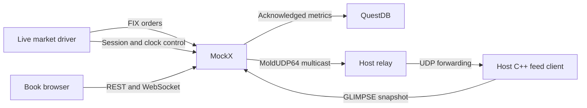

# Docker and Live Demo

The repository-root Compose stack runs a complete market: MockX, QuestDB 9.4.3, a continuous FIX market driver, and a MoldUDP64 relay for host-side feed clients. Docker builds the Python/QuickFIX environment, so the host needs Docker and Compose but does not need a local Python installation for this path.

Run commands from the repository root at the [documented source revision](https://github.com/lehajamb/mockx/blob/556e28b533171ceee63864e396faedfb2ef7aa8e/docker-compose.yml). The default relay targets `host.docker.internal`, matching Docker Desktop; on other Docker hosts, ensure that name resolves to the intended host interface before expecting host-side UDP delivery.

## Start and observe

```text
docker compose up --build
```

For detached operation:

```text
docker compose up --build -d
docker compose ps
docker compose logs -f live-market
```

QuestDB must pass its authenticated health check before MockX starts. The driver waits for MockX readiness and the relay service to start, then owns the simulation session, maintains passive maker liquidity, submits taker orders, and repeatedly advances the external clock. Open [the live book](http://localhost:8001/ui/BTC-USDT).

The driver uses two FIX sessions mapped to different participants, `demo-liquidity` and `demo-taker`. Its resulting fills respect mandatory self-trade prevention. Do not manually start another session or drive the clock concurrently with the driver during this demo.

## Ports and topology

| Service | Inside Compose | Host access |
|---|---|---|
| FIX acceptor | `mockx:4001` | `localhost:4001` |
| REST, WebSocket, UI, Prometheus | `http://mockx:8000` | `http://localhost:8001` |
| GLIMPSE over SoupBinTCP | `mockx:18001/TCP` | `127.0.0.1:18001/TCP` |
| ITCH over MoldUDP64 | `239.192.0.1:18000/UDP` | Relay forwards to host UDP port `18000` |
| QuestDB console, SQL, ingestion | `questdb:9000` | `http://localhost:9000` |
| QuestDB PostgreSQL wire | `questdb:8812` | `localhost:8812` |
| QuestDB health | `questdb:9003` | `http://localhost:9003` |

The API's host port is `8001`; the container's API port is `8000`. Browser WebSockets use the UI's current origin. There is no separate Prometheus server port.



The relay joins multicast inside the Compose network and forwards the received packets to the host. It is not a Docker published UDP port. Host-side clients still validate the Mold session and sequence. The Docker exchange enables ITCH and GLIMPSE; the local live-demo YAML disables both unless changed.

## Health and diagnostics

With Bash/curl:

```bash
curl -f http://localhost:8001/readyz
curl -f http://localhost:8001/book/BTC-USDT
curl --fail --user mockx-user:mockx-password http://localhost:9003
```

With PowerShell:

```powershell
Invoke-RestMethod http://localhost:8001/readyz
Invoke-RestMethod http://localhost:8001/book/BTC-USDT
```

The checked-in QuestDB username/password are `mockx-user` / `mockx-password`, intended only for this development stack. The console is at [localhost:9000](http://localhost:9000). Enabled persistence is required for traffic readiness; a healthy exchange core alone does not make `/readyz` succeed during a persistence outage.

Useful service logs:

```text
docker compose logs mockx
docker compose logs questdb
docker compose logs mold-host-relay
```

If the book is static, check driver output and readiness. If host feeds fail while the browser works, inspect the relay, host UDP port availability, and `host.docker.internal` resolution. For integrity loss or failed runs, follow [Metrics and Persistence](https://github.com/lehajamb/mockx/wiki/Metrics-and-Persistence).

## Stop or reset

Stop the demo and remove containers while retaining database contents:

```text
docker compose down
```

The database is stored in the named `questdb-data` volume. To deliberately discard that demo database as well:

```text
docker compose down -v
```

## Run the continuous driver without Docker

After completing the local Python installation, start the two-session exchange in terminal 1:

```text
python -m src.mockx.cli --config examples/live_exchange.yml --fix-config examples/live_acceptor.cfg
```

In terminal 2:

```text
python examples/live_market.py --config examples/live_exchange.yml --fix-config examples/live_client.cfg --base-url http://127.0.0.1:8001
```

The driver owns lifecycle and clock advancement here too. Run `python examples/live_market.py --help` for bounded-run and market-shape options. Its local configuration disables QuestDB and binary feeds; the same browser book remains available on port `8001`.

The two-venue [C++ Smart Order Router](https://github.com/lehajamb/mockx/wiki/Cpp-Smart-Order-Router) has a separate Compose file and deterministic one-shot seeder. Use its guide for that topology.

Sources: [Compose stack](https://github.com/lehajamb/mockx/blob/556e28b533171ceee63864e396faedfb2ef7aa8e/docker-compose.yml), [Docker exchange configuration](https://github.com/lehajamb/mockx/blob/556e28b533171ceee63864e396faedfb2ef7aa8e/examples/live_exchange_docker.yml), [live market driver](https://github.com/lehajamb/mockx/blob/556e28b533171ceee63864e396faedfb2ef7aa8e/examples/live_market.py), [host relay](https://github.com/lehajamb/mockx/blob/556e28b533171ceee63864e396faedfb2ef7aa8e/examples/moldudp64_host_relay.py).
