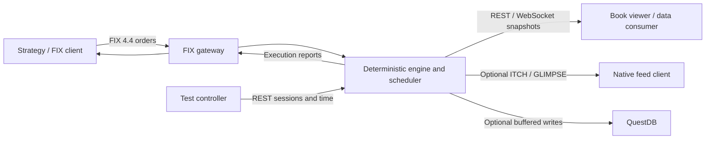

# MockX Wiki

MockX is a deterministic mock exchange for strategy tests and simulation. It combines a price-time-priority order book with FIX 4.4 order entry, a controllable simulated clock, REST administration, WebSocket market data, and optional QuestDB persistence.

This wiki documents published `main` at [556e28b](https://github.com/lehajamb/mockx/tree/556e28b533171ceee63864e396faedfb2ef7aa8e), reviewed on 29 October 2026. Commands assume that revision. Unmerged development features are outside this documentation.

MockX is a simulator, not a production trading venue.

## Choose a starting point

| Goal | Read next |
|---|---|
| Run the exchange and submit your first FIX orders | [Getting Started](https://github.com/lehajamb/mockx/wiki/Getting-Started) |
| Watch a continuously populated book with QuestDB | [Docker and Live Demo](https://github.com/lehajamb/mockx/wiki/Docker-and-Live-Demo) |
| Connect a strategy or test client | [FIX Trading](https://github.com/lehajamb/mockx/wiki/FIX-Trading), then [Sessions and Simulated Time](https://github.com/lehajamb/mockx/wiki/Sessions-and-Simulated-Time) |
| Read a book or consume market data | [REST API](https://github.com/lehajamb/mockx/wiki/REST-API) and [WebSocket Market Data](https://github.com/lehajamb/mockx/wiki/WebSocket-Market-Data) |
| Explore a native binary market-data client | [ITCH and GLIMPSE](https://github.com/lehajamb/mockx/wiki/ITCH-and-GLIMPSE) and [C++ Market Feed Client](https://github.com/lehajamb/mockx/wiki/Cpp-Market-Feed-Client) |
| Route orders across two simulated venues | [C++ Smart Order Router](https://github.com/lehajamb/mockx/wiki/Cpp-Smart-Order-Router) |
| Understand or change the implementation | [Architecture](https://github.com/lehajamb/mockx/wiki/Architecture), [Matching Engine and Scheduler](https://github.com/lehajamb/mockx/wiki/Matching-Engine-and-Scheduler), and [Development and Troubleshooting](https://github.com/lehajamb/mockx/wiki/Development-and-Troubleshooting) |

## Interface map

| Surface | Responsibility |
|---|---|
| FIX 4.4 | New orders, cancellations, replacements, execution reports, and rejects |
| REST | Session lifecycle, external clock advancement, book inspection, health, and stats |
| WebSocket | Immutable book snapshots, trades, and application heartbeats |
| ITCH 5.0 over MoldUDP64 | Experimental downstream displayed-order feed |
| GLIMPSE 5.0 over SoupBinTCP | Optional snapshot and bounded interrupted-spin recovery for the binary feed |

REST and WebSocket do not submit live orders. A Market Data Request over FIX is rejected; use the documented market-data surfaces.

## Behavior to know before integrating

- Prices and quantities are validated against exact instrument ticks and lots. Public decimal values are strings where specified by the protocol; preserve their precision.
- Limit and market orders support GTC and IOC. IOC and market remainders never rest.
- Every order belongs to a configured participant. Self-trade prevention is mandatory and cancels both remainders at the first same-participant crossing encounter.
- A replacement uses a new client ID and the latest accepted original client ID. Price changes and quantity increases lose queue priority.
- External time advancement is inclusive: events exactly at the target are processed. Equal-time scheduler events retain FIFO ordering.
- Session lifecycle, FIX delivery, and scheduler failure states are separate. Use the recovery guidance for the component that failed.
- FIX delivery queues live in process memory. The exchange does not promise durable, end-to-end exactly-once delivery.
- WebSocket sequence numbers are global to the exchange and snapshots may be conflated. A gap alone does not prove that a subscriber lost a trade.

## Configure and operate

[Configuration](https://github.com/lehajamb/mockx/wiki/Configuration) explains instrument grids, latency, participant ownership, delivery bounds, feeds, and persistence settings.

[Metrics and Persistence](https://github.com/lehajamb/mockx/wiki/Metrics-and-Persistence) explains readiness, process metrics, clock units, QuestDB buffering, and failure recovery.

[Development and Troubleshooting](https://github.com/lehajamb/mockx/wiki/Development-and-Troubleshooting) collects test workflows, operational symptoms, and wiki maintenance guidance.

## Related resources

- [Source repository](https://github.com/lehajamb/mockx)
- [README at the documented revision](https://github.com/lehajamb/mockx/blob/556e28b533171ceee63864e396faedfb2ef7aa8e/README.md)
- [Interactive architecture, engine, and scheduler documentation](https://lehajamb.github.io/mockx/) — follows its own deployment and may advance beyond this wiki's pinned source revision.
- [Documentation changelog](https://github.com/lehajamb/mockx/blob/556e28b533171ceee63864e396faedfb2ef7aa8e/doc/CHANGELOG.md)
