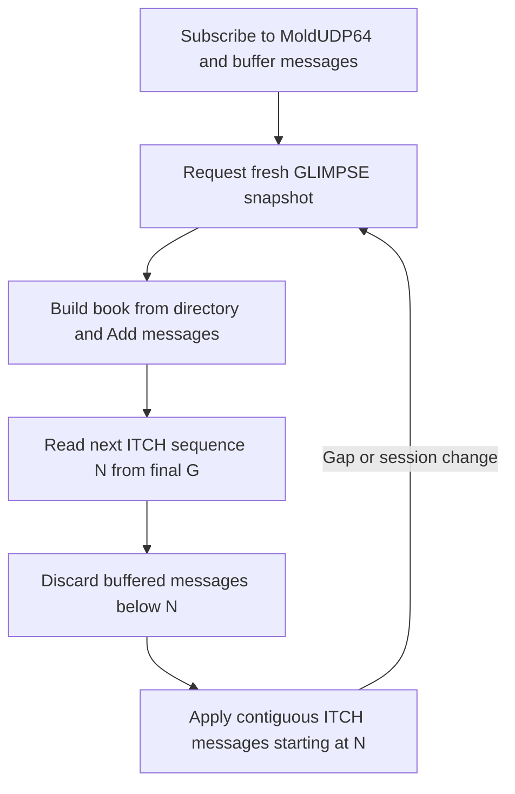

# ITCH and GLIMPSE

MockX optionally publishes an experimental Nasdaq ITCH 5.0 displayed-order feed over MoldUDP64 multicast and an atomic GLIMPSE 5.0 snapshot service over SoupBinTCP. These interfaces support deterministic market-data tests; they are not a production exchange feed or a complete implementation of every Nasdaq message type.

For a working consumer, see [C++ Market Feed Client](https://github.com/lehajamb/mockx/wiki/Cpp-Market-Feed-Client). FIX remains the live order-entry interface.

## Enable the services

Merge these sections into a valid exchange YAML configuration. The sample `GLIMP` credentials are demonstration values for a trusted test environment.

```yaml
itch:
  enabled: true
  market_category: " "
  financial_status: " "
  round_lot_size: 1
moldudp64:
  multicast_group: 239.192.0.1
  multicast_port: 18000
  session_prefix: MX
  heartbeat_interval_ms: 1000
  max_payload_bytes: 1400
  interface_address: 0.0.0.0
  ttl: 1
glimpse:
  enabled: true
soupbintcp:
  host: 127.0.0.1
  port: 18001
  session_prefix: GS
  credentials:
    GLIMP: CHANGE_ME
  login_timeout_ms: 30000
  write_timeout_ms: 5000
  max_connections: 64
  replay_ttl_ms: 60000
  max_cached_sessions: 32
  max_cached_bytes: 67108864
```

ITCH requires valid MoldUDP64 settings and an IPv4 multicast destination. GLIMPSE additionally requires SoupBinTCP. The listener is process-lifetime, while feed coherence and snapshots are run-scoped. Start a simulation through the [REST API](https://github.com/lehajamb/mockx/wiki/REST-API) before requesting a fresh snapshot.

Feed ports are separate from FIX and HTTP. Container-to-host multicast may require the provided relay; see [Docker and Live Demo](https://github.com/lehajamb/mockx/wiki/Docker-and-Live-Demo). Do not treat publishing a Docker TCP port as enabling UDP multicast delivery.

## ITCH units and identities

One internal quantity lot is one ITCH share. If `lot_size` is `0.001`, an ITCH share count of 6 means `0.006` base units. Lot size is out-of-band instrument metadata; it is not multiplied into the wire share field.

Price(4) is exactly `price_ticks * tick_size * 10000`, without rounding. Enabled ITCH requires ASCII symbols of at most eight bytes and tick sizes exactly representable at four decimal places. The FIX boundary rejects quantities that cannot fit an unsigned 32-bit share field and prices above `200000.0000` before scheduling.

Displayed Order Reference Numbers are run-local placement identities, separate from stable FIX order IDs. Every new placement gets a fresh reference; a deleted reference is never reused within the Mold session. A priority-preserving reduction keeps its displayed reference. A priority-losing amendment gets a new reference if it rests again.

## Displayed-order messages

Only authoritative committed book changes, after invariant validation, generate displayed-order events. Client execution reports do not independently generate ITCH fills.

| Engine action | ITCH publication |
|---|---|
| GTC LIMIT remainder first rests | Add Order without MPID (`A`) for resting leaves |
| Fill consumes a displayed passive order | Order Executed (`E`), or Executed With Price (`C`) if needed |
| Explicit cancellation or self-trade prevention removes displayed leaves | Order Delete (`D`) |
| Replacement reduces leaves and preserves FIFO | Order Cancel (`X`) with removed shares |
| Replacement loses FIFO | Old-reference `D`, passive `E/C` for fills, then new-reference `A` if leaves rest |
| No-op or rejected replacement | No book change publication |

One fill emits exactly one passive-side `E` or `C`; Match Number is the engine fill's trade ID. MARKET/IOC remainders never rest, so they never receive an Add for an unexecuted remainder. Run boundaries also publish system/directory/trading-state messages. This version does not publish `F`, `U`, `P`, `Q` or `B`.

A changed book publishes one final immutable REST/WebSocket snapshot separately from its order-by-order feed events. These interfaces have different sequencing and should not be conflated.

## MoldUDP64 sequencing

A successful simulation run opens a fresh ten-byte Mold session: the one- or two-byte configured prefix padded with `_` to two bytes, followed by the eight-digit run generation. Prefix `MX` and generation 1 produce `MX00000001`.

Sequence 1 identifies the first ITCH message. A data packet advances the next sequence by its Message Count, rather than by one per UDP packet. Heartbeats (`Message Count=0`) and end-of-session packets (`0xffff`) carry the next sequence without consuming it. Large message batches split into packets without reordering.

Heartbeats use simulated scheduler time and are sent at the configured cadence only for an interval without a data packet. External clock mode therefore requires advancing simulated time to drive them.

The transport is downstream-only: it does not listen for Mold request packets, retain a retransmission history or serve retransmissions. Without GLIMPSE, recovery from a gap requires a later coherent MockX run. With GLIMPSE, a consumer can buffer live data and obtain a fresh atomic snapshot in the same coherent run.

## GLIMPSE snapshot and live-stream stitch



A fresh Soup Login Request uses an all-space Requested Session and Requested Sequence Number 1. Login Accepted is followed by one Soup Sequenced Data (`S`) packet per higher-level message:

1. Stock Directory (`R`) for every instrument in locate-code order.
2. Stock Trading Action (`H`) with state `T` for each instrument.
3. Unattributed Add Order (`A`) for every resting order's current leaves. Instruments follow locate order; each book is bids best-to-worst/FIFO, then asks best-to-worst/FIFO.
4. End of Snapshot (`G`) containing the next ITCH message sequence as a 20-byte, left-space-padded decimal value.

The engine book and next Mold sequence are copied under the same lifecycle lock after invariant validation. Encoding and TCP writes occur after releasing the lock, so a slow snapshot client cannot hold up matching or clock advancement.

Soup sequence and ITCH sequence are distinct. Soup sequence resumes an interrupted snapshot's own immutable message stream; the final `G` gives the handoff into live ITCH. Start buffering multicast before requesting the snapshot to avoid missing messages that arrive during the spin.

## Login, replay and limits

Soup usernames/passwords are case-insensitive fixed-width ASCII, with widths of 1–6 and 1–10 characters respectively. The service handles TCP fragmentation/coalescing, client/server heartbeats, login/write timeouts, logout and clean End of Session (`Z`). It supplies protocol credentials, not TLS or production authentication.

If TCP fails before a snapshot completes, its immutable messages can be resumed by named Soup session and next expected Soup sequence until the replay TTL expires. Connection count, cached sessions and aggregate bytes are bounded. Capacity exhaustion rejects a new login with reason `S` instead of evicting a replayable spin. Restarting the process loses cached spins; request a fresh sequence-1 snapshot afterward.

A listener may be bound while no run is active. Authenticated login is still rejected with reason `S` unless lifecycle is `ACTIVE` or `RUN_FAILED`, the scheduler is not failed and the current ITCH session remains coherent. A run failed by persistence loss can therefore provide its preserved book even though new trading is blocked.

MockX has no dynamic halt, Reg SHO, RPII or operational-halt state; snapshot output is limited to `R`, `H`, `A`, `G`.

## Failure and observability

A runtime encoder/socket failure degrades ITCH and revokes GLIMPSE access to the affected run. Matching, FIX, REST and WebSocket remain available. If the core and enabled persistence remain healthy, `/readyz` returns HTTP 200 with `status: "degraded"`. The feed does not restart within that run; the next generation attempts a fresh session.

Run end/reset/shutdown revokes active and cached GLIMPSE spins before ITCH end markers. Inspect `/stats.itch` for feed state, Mold session, next message sequence, messages, packets, heartbeats and failures. `/stats.glimpse` exposes listener state, active connections, cache gauges, fresh/resumed/completed/rejected sessions, bytes, timeouts and failures.

## Source references

- [ITCH publisher and run lifecycle](https://github.com/lehajamb/mockx/blob/556e28b533171ceee63864e396faedfb2ef7aa8e/src/mockx/itch_delivery.py)
- [ITCH encoding](https://github.com/lehajamb/mockx/blob/556e28b533171ceee63864e396faedfb2ef7aa8e/src/mockx/itch_encoder.py)
- [MoldUDP64 transport](https://github.com/lehajamb/mockx/blob/556e28b533171ceee63864e396faedfb2ef7aa8e/src/mockx/moldudp64_transport.py)
- [GLIMPSE service](https://github.com/lehajamb/mockx/blob/556e28b533171ceee63864e396faedfb2ef7aa8e/src/mockx/glimpse_service.py)
- [GLIMPSE contract tests](https://github.com/lehajamb/mockx/blob/556e28b533171ceee63864e396faedfb2ef7aa8e/tests/test_glimpse_service.py)
- [Feed replacement tests](https://github.com/lehajamb/mockx/blob/556e28b533171ceee63864e396faedfb2ef7aa8e/tests/test_replace_feeds.py)
