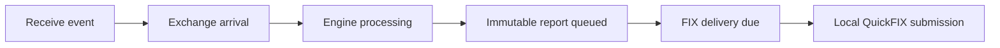

# Matching Engine and Scheduler

This page explains how accepted FIX commands become deterministic book changes and immutable reports. Wire fields and client examples are in [FIX Trading](https://github.com/lehajamb/mockx/wiki/FIX-Trading).

## Exact matching and order state

Authoritative prices are integer ticks, quantities are integer lots, and filled notional is accumulated exactly. The normalization boundary rejects nonfinite, nonpositive, and off-grid values rather than rounding them. Display serialization formats values using the configured instrument scale; floating-point display values never determine a match.

A new command creates a `PENDING_NEW` order and schedules its initial processing. The queued `ProcessOrderCommand` carries an expected order version, so a canceled or superseded pending order cannot be revived by stale work. Processing consumes the new-order rejection draw once, then matches and finalizes any remainder.

| Result | State and book behavior |
|---|---|
| Unfilled GTC limit | `NEW`; rests at its price level |
| Partially filled GTC limit | `PARTIAL`; its remaining leaves rest without returning to `NEW` |
| Fully executed order | `FILLED`; absent from the book |
| IOC remainder | Canceled; never rests |
| Market remainder, regardless of TIF | Canceled; never rests |
| Rejected command | `REJECTED`; never rests |

The internal cancellation enum is `CANCELLED`; FIX execution type terminology uses `CANCELED`.

For an incoming BUY, matching takes the lowest ask first; for SELL, the highest bid. Within a price level it takes the oldest resting order. Each fill executes at the passive order's price and consumes the smaller of the two leaves quantities. Both orders and the passive level aggregate are validated before quantities are committed.

Each fill produces one passive execution report followed by one aggressor report at the same simulated timestamp. Reports are frozen snapshots, so later fills cannot alter previously queued cumulative quantities or status. A large incoming order can therefore produce multiple distinct trade reports rather than one report aggregating every fill.

## Self-trade prevention

When the first eligible passive order has the same participant as the aggressor, MockX cancels both complete remainders and stops that aggressor's matching loop. It creates no trade ID or volume for the prevented cross. Any earlier fills against other participants remain in cumulative quantity and average price. Passive cancellation is reported first.

The policy is unconditional. Assigning different session aliases does not bypass it; ownership comes from configured participant mappings.

## Cancel and replace at execution time

Cancel target lookup happens when the engine processes the request, not when the FIX callback receives it. The owner can cancel a pending or resting live order. A pending cancel advances the version, making its older processing command harmless. A fill that executes first can make a later cancel too late.

Native replacement applies only to a resting `NEW`/`PARTIAL` GTC limit order and uses total order quantity, including previous fills:

| Amendment | Priority and outcome |
|---|---|
| Same price, smaller total quantity above cumulative fills | Retain FIFO and displayed reference; reduce leaves atomically |
| Same price and total quantity | Acknowledge the new client ID; no book mutation |
| Price change or quantity increase | Remove old liquidity, lose FIFO, match again, then rest remaining leaves at the back |
| Total quantity at or below cumulative fills | Clamp total to actual fills, remove leaves, finish `FILLED` without a new trade |

The original exchange `OrderID`, ownership, submission time, cumulative fills, and filled notional remain. The latest accepted `ClOrdID` becomes the required reference for future cancel/replace requests. Replacement acknowledgment precedes replacement-triggered fills. A replacement does not draw a new simulated rejection probability.

## Displayed-order events

The engine buffers protocol-neutral displayed-order events during a command and publishes them in mutation order after its invariant check. ITCH is derived from those authoritative mutations, not reconstructed from execution reports.

- `DisplayedOrderAdded`: a GTC limit remainder actually enters the book.
- `DisplayedOrderExecuted`: one fill of a displayed passive order.
- `DisplayedOrderDeleted`: displayed leaves leave without execution, including a resting cancel, STP removal, or priority-losing replacement.
- `DisplayedOrderReduced`: a quantity reduction preserves FIFO and its reference.

A never-resting aggressor produces no add/delete pair. A no-op replacement produces no displayed event. See [ITCH and GLIMPSE](https://github.com/lehajamb/mockx/wiki/ITCH-and-GLIMPSE).

## Two layers of deterministic ordering

QuickFIX callbacks parse immutable normalized commands and hand them to the central ingress sequencer. A captured batch is sorted by:

```text
(simulated receive timestamp,
 complete stable QuickFIX SessionID.toString(),
 FIX MsgSeqNum,
 run-local ingress sequence)
```

The ingress sequence is the final tie-break and resets at a successful simulation start. It is not the sole arrival-order criterion.

Once receive events enter the scheduler, the heap orders events by simulated timestamp and monotonically increasing scheduler sequence. Equal-time scheduled events retain insertion order, including events added by a handler. Commands already queued at that timestamp keep priority over later insertions.



This diagram shows causal stages. Arrival and processing events are scheduled with their respective delays; the engine does not sleep between them. Cancel uses `cancel_received`, `cancel_arrived_at_exchange`, `cancel_engine_process`, and shared `fix_delivery_due`; replacement has its corresponding `replace_*` stages. Requester session delay, inbound latency, engine latency, and outbound latency determine when these stages are eligible.

## Advancement and failure

`run_until(target)` processes all eligible events through the target inclusively, including events exactly at the target and zero-delay work they schedule. A shared event budget covers the entire advancement. The default is 100,000 successfully handled events; another eligible event beyond that budget causes `EVENT_PROCESSING_LIMIT_EXCEEDED` and fails the scheduler.

`run_until_idle()` is an in-process helper that drains queued work without moving time backward. Overdue work executes at the current simulated time while retaining its original scheduled timestamp. An empty queue leaves time unchanged. Do not use this helper as an HTTP endpoint; public clock control is documented in [Sessions and Simulated Time](https://github.com/lehajamb/mockx/wiki/Sessions-and-Simulated-Time).

In-process tests using FIX callbacks should await `exchange.fix_app.wait_for_ingress()` before directly advancing the scheduler. Its captured run generation and high-water sequence ensure that the intended commands have entered scheduler receive events. Administrative and realtime advancement perform this barrier internally.

An unhandled handler exception or missing handler moves the event into one immutable dead-letter record and changes the scheduler to `FAILED`. Later events remain queued, but new scheduling and clock movement are rejected. The run may contain partial mutations; it is not rolled back. Inspect `/stats.scheduler.dead_letter`, end the run, and start a new run instead of retrying the failed event.

## Reliable FIX delivery

Execution reports and cancel rejects enter a process-lifetime queue once at creation. Per stable session, only the oldest undelivered record may be submitted. Records retain their original IDs, run generation, immutable payload, due time, attempts, and state:

`PENDING`, `DUE`, `RETRY_PENDING`, `DELIVERED`, or `PERMANENTLY_FAILED`.

Disconnected transports retain due work. Transport errors and `sendToTarget(...) == False` use bounded retry cycles. Logon installs the current transport and starts an immediate bounded cycle; logout removes only the transport. Due commands carry versions so obsolete retries cannot override a newer deadline or revive an exhausted cycle.

A deterministic serialization failure permanently blocks that session's FIFO head; another session still progresses. Delivered payload retention is bounded, with tombstones protecting deduplication while relevant work can remain. Nonterminal and blocking records are not pruned.

A successful local QuickFIX submission ends MockX application retries. QuickFIX owns protocol sequencing, resend, and message-store behavior; ambiguous transport outcomes can still produce client-visible duplicates. The application queue does not survive a process or host restart.

## Correctness invariants

After each completed engine command:

1. If both sides exist, best bid is strictly below best ask.
2. Every live book order is `NEW` or `PARTIAL`; terminal orders are absent.
3. IOC and market orders never rest.
4. Each level aggregate equals the sum of its queued leaves, and lookup indexes agree with queues.
5. Reports are immutable snapshots.
6. Equal-time events retain deterministic order and target-time events are included.
7. Each logical persisted event has a unique identity.

These are requirements for changes, not assertions to relax when a regression test fails.

## Sources

- Pinned [matching engine](https://github.com/lehajamb/mockx/blob/556e28b533171ceee63864e396faedfb2ef7aa8e/src/mockx/engine.py), [models and order book](https://github.com/lehajamb/mockx/blob/556e28b533171ceee63864e396faedfb2ef7aa8e/src/mockx/models.py), [scheduler](https://github.com/lehajamb/mockx/blob/556e28b533171ceee63864e396faedfb2ef7aa8e/src/mockx/latency.py), and [delivery queue](https://github.com/lehajamb/mockx/blob/556e28b533171ceee63864e396faedfb2ef7aa8e/src/mockx/delivery.py).
- Interactive [matching engine](https://lehajamb.github.io/mockx/mockx-engine.html) and [scheduler, timing, and delivery](https://lehajamb.github.io/mockx/mockx-scheduler.html) guides.
