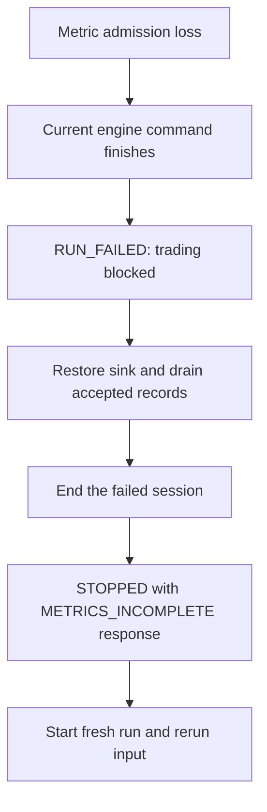

# Metrics and Persistence

MockX separates run results, process-wide operations, and persistence integrity. Use `/stats` for structured diagnosis and `/metrics` for Prometheus scraping. Persistence to QuestDB is optional when disabled; when enabled, it is required for traffic readiness.

## Inspect a running exchange

The shipped local configuration publishes the API on port 8001:

```bash
curl -f http://127.0.0.1:8001/healthz
curl -f http://127.0.0.1:8001/readyz
curl -f http://127.0.0.1:8001/stats
curl -f http://127.0.0.1:8001/metrics
```

A failed readiness response still contains useful JSON; inspect its body when `curl -f` reports HTTP 503. A live process is not necessarily ready to accept traffic.

| Surface | Scope and interpretation |
|---|---|
| `/stats` business fields | `scope="current_run"`; orders, trades, cancellations, replacements, reports, book, and latency reset after successful end |
| `/stats.process_lifetime` | Cumulative business counters and duration aggregates |
| `/stats.scheduler` | Current scheduler state, queue depth, event budget, and dead-letter diagnostics |
| `/stats.fix_delivery`, `.websocket`, `.itch`, `.glimpse` | Operational gauges/counters with their own scope labels |
| `/stats.persistence` | Buffer/sink health, lifetime outcomes, and current-run integrity |
| Session end `final_stats` | Snapshot of the ended run, without lifetime FIX/WebSocket/persistence totals |
| `/metrics` | Process-lifetime monotonic Prometheus collectors and current gauges on the API port |

Prometheus counters do not reset when a simulation ends. Each application instance owns its registry, allowing multiple exchanges in one process without duplicate global registration.

## Timing and delivery measurements

Configured new-order, cancel, and replacement stage delays use simulated time and milliseconds. CPU work uses a real monotonic clock and microseconds. Do not compare their values as if they described the same clock.

| Measurement family | Examples |
|---|---|
| Simulated cancel latency | `mockx_sim_cancel_inbound_latency_ms`, `mockx_sim_cancel_engine_latency_ms`, `mockx_sim_cancel_outbound_latency_ms`, `mockx_sim_cancel_end_to_end_latency_ms` |
| Simulated replacement latency | Corresponding `mockx_sim_replace_*_latency_ms` histograms |
| CPU duration | `mockx_match_loop_duration_us`, `mockx_book_commit_duration_us`, `mockx_engine_command_duration_us`, `mockx_report_creation_duration_us`, `mockx_serialization_duration_us` |
| Scheduler health | `mockx_scheduler_pending_events`, `mockx_scheduler_failed`, `mockx_scheduler_dead_letters_total` |
| FIX delivery | `mockx_fix_delivery_queue_depth`, `mockx_fix_delivery_attempts_total`, `mockx_fix_delivery_retries_total`, `mockx_fix_delivery_permanent_failures_total` |
| WebSocket delivery | `mockx_websocket_outbound_queue_depth`, `mockx_websocket_snapshots_conflated_total`, `mockx_websocket_slow_client_disconnects_total` |

Logical fills, reports, and rejects are counted by their domain identities. A transport retry increments attempt metrics without creating another logical trade or report. Pending terminal delivery retains its latency trace; successful retry records completion once. A replacement request is not another submitted/accepted order, and quantity clamping does not create trade volume.

FIX backlog can report `components.fix_delivery="degraded"` with HTTP 200 when core readiness is otherwise satisfied. Inspect the queue head: a retry-pending record can recover at logon; a permanently failed serialization record blocks its session across reconnect and run reset.

The Compose stack includes neither a Prometheus server nor Grafana dashboards. An independently deployed Prometheus on its network can scrape `mockx:8000/metrics`.

## QuestDB configuration

The Docker demo uses QuestDB 9.4.3. Its Web Console and REST/ILP service use port 9000, PostgreSQL wire service 8812, and health endpoint 9003.

This is the documented bounded-buffer configuration; the hostname `questdb` resolves inside the Compose network:

```yaml
questdb:
  enabled: true
  url: http://questdb:9000
  health_url: http://questdb:9003
  username: mockx-user
  password: mockx-password
  flush_batch_size: 1000
  max_buffer_records: 10000
  max_buffer_bytes: 67108864
  flush_interval_ms: 1000
  retry_backoff_ms: 1000
  max_retry_delay_ms: 30000
  overflow_retry_attempts: 3
  shutdown_timeout_ms: 10000
  overflow_policy: reject_new
  request_timeout_ms: 10000
```

The bundled credentials are development-only values. See [Configuration](https://github.com/lehajamb/mockx/wiki/Configuration) for supported environment overrides and [Docker and Live Demo](https://github.com/lehajamb/mockx/wiki/Docker-and-Live-Demo) for deployment commands.

## Buffering, retries, and run integrity

One coalesced worker handles threshold, interval, health probe, and retry signals. Explicit drains use the same flush lock. Queued and in-flight records and their logical encoded bytes all count toward capacity.

Admission has explicit outcomes: `ACCEPTED`, `ACCEPTED_FLUSH_REQUIRED`, `ACCEPTED_DROPPED_OLDEST`, `REJECTED_CLOSED`, `REJECTED_FULL`, or `FAILED`. Nonblocking `add_nowait()` never waits or reports success after close.

- Default `reject_new` preserves every accepted record but rejects admission once capacity is exhausted.
- Optional `drop_oldest` can evict only queued records, never in-flight or delivery-required records.
- Either a rejection or eviction of a run record permanently makes that run incomplete. There is no unbounded fallback queue.
- A failed sink write that retains every row for retry does not itself invalidate run integrity.

Failed batches return to the queue in original order with the same identities and payloads. Automatic retry waits use real monotonic time, start at `retry_backoff_ms` after a failed sink operation completes, and double up to `max_retry_delay_ms`, without jitter. Producer activity cannot bypass or extend that deadline. Explicit flush, session end, sink replacement, and shutdown's final drain remain immediate attempts with their own timeouts.

Persistence health is current state: `DISABLED`, `HEALTHY`, `RETRYING`, `DEGRADED`, `UNAVAILABLE`, or `CLOSED`. A successful write clears consecutive failure/retry state. A healthy probe can do that only when no queued or in-flight records remain; it cannot erase a backlog of retained failures. Lifetime failure totals remain cumulative.

Run integrity is separate. `/stats.persistence.current_run_outcomes.integrity_complete` stays false after the first permanent loss until a fresh run starts. `/stats.run_failure` identifies the first loss, its run generation, simulated time, reason, and attempted metric sequence.

## Recovering an incomplete run



When loss occurs during a command, its remaining fills, reports, and market-data updates finish before further trading is gated. Subsequent queued orders are rejected; queued cancels/replacements do not change targets. New FIX ingress receives `METRICS_INCOMPLETE`.

Delivery, inspection, and feed servicing remain available. Clock advancement returns HTTP 503 with `METRICS_INCOMPLETE`, actual clock position, processed/pending counts, and run failure details. It never reports successful simulation advancement after permanent loss. This differs from scheduler failure, which prevents time movement entirely.

Restore QuestDB, then call `POST /api/v1/session/end`. If accepted rows cannot drain, the endpoint returns `METRICS_FLUSH_FAILED` and keeps the run open for retry. Once draining succeeds, a failed run closes to `STOPPED` but still returns HTTP 503 with `status="session_failed"`, `METRICS_INCOMPLETE`, and final statistics. This error records historical loss; it does not mean closure failed. Starting before closure returns `409 RUN_REQUIRES_END`.

Start a new run and replay the input. Sink recovery cannot recreate rejected or evicted records, and readiness stays HTTP 503 for `RUN_FAILED` even after the sink becomes healthy. Process restart is not needed for this recovery path.

Shutdown seals admission and makes one timeout-bounded final drain/close attempt. Its typed result reports the exact unflushed count instead of treating an incomplete close as success.

## Persisted data and identity

Every row stores the actual event time as designated `TIMESTAMP_NS`, plus the same integer nanosecond value in `event_timestamp_ns`. A one-based `metric_event_sequence` spans all persistence tables within a run. Identity is allocated before admission and is never reused after a rejection or failure.

All tables are daily-partitioned WAL tables with deduplication on `(timestamp, run_id, metric_event_sequence)`. Equal-time events remain distinct. Retries resend the original keys, so QuestDB upserts the same logical row instead of adding a duplicate.

| Table | Production content |
|---|---|
| `orders` | Immutable execution-report/revision snapshots |
| `trades` | Completed fills |
| `self_trade_prevention` | Prevented crosses and ownership audit data |
| `latency` | Typed simulated and measured-duration samples |
| `fix_messages` | Message counts by direction/type |
| `book_snapshot` | Complete immutable book state per committed update, plus initial empty state per symbol |
| `fix_connections` | Schema/helper exists; ordinary production wiring does not write rows |
| `pending_events` | Schema/helper exists; ordinary production wiring does not write rows |

Connection counts and pending-event counts are operational gauges even though the last two table helpers are unused. Do not interpret their empty tables as missing gauge updates.

Book rows contain a complete current image, including empty or one-sided books, canonical price/quantity strings, and level arrays. Read the latest complete sequence; never retain old deeper levels when a newer snapshot shrinks.

Use the QuestDB Web Console to inspect a run:

```sql
SELECT timestamp, run_id, metric_event_sequence, event_timestamp_ns,
       exchange, symbol, price, quantity
FROM trades
WHERE run_id = 'quickstart'
ORDER BY metric_event_sequence;
```

Replaying the same logical run with the same `run_id` and inputs intentionally reproduces its identities. Use a distinct `run_id` for a distinct logical run.

## Existing database migration

Startup verifies the fixed schema and does not automatically alter existing tables. ILP table/column auto-creation is disabled in the bundled server. If a database predates native replacement, stop the exchange and add each of these columns only when absent:

```sql
ALTER TABLE orders ADD COLUMN exec_type SYMBOL;
ALTER TABLE orders ADD COLUMN cl_ord_id VARCHAR;
ALTER TABLE orders ADD COLUMN orig_cl_ord_id VARCHAR;
```

Historical rows remain null in added columns; identity, timestamp, and deduplication rules are unchanged.

## Sources

Pinned [metrics and writer](https://github.com/lehajamb/mockx/blob/556e28b533171ceee63864e396faedfb2ef7aa8e/src/mockx/metrics.py), [QuestDB sink and schemas](https://github.com/lehajamb/mockx/blob/556e28b533171ceee63864e396faedfb2ef7aa8e/src/mockx/questdb_writer.py), [README metrics reference](https://github.com/lehajamb/mockx/blob/556e28b533171ceee63864e396faedfb2ef7aa8e/README.md#10-metrics-and-observability), and [persistence failure regression tests](https://github.com/lehajamb/mockx/blob/556e28b533171ceee63864e396faedfb2ef7aa8e/tests/test_persistence_run_failure.py).
