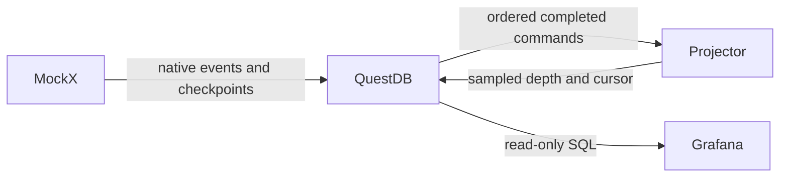

# MockX QuestDB dashboard

The browser viewer runs outside MockX. The exchange writes its typed native
`exchange_events` journal; this projector reconstructs completed commands and
creates disposable 40-level bid/ask projections in QuestDB. Grafana reads those
projections through QuestDB's native PostgreSQL-wire data source.



## Run

From the repository root:

```powershell
docker compose up --build
```

Open [the dashboard](http://localhost:3000/d/mockx-native/mockx-native-exchange).
Anonymous access has Grafana's Viewer role. Log in with `admin` /
`mockx-dashboard` for administration. The example credentials are local demo
values; use your own deployment credentials when publishing services.

The [two-venue SOR stack](../cpp_sor/README.md) includes the same projector and
dashboard at [port 3001](http://localhost:3001/d/mockx-native/mockx-native-exchange).
Select the venue, run UUID, and symbol independently. A scenario label is shown
with the source cursor; UUIDs distinguish repeated scenarios and restarts.

For a local projector against an existing exchange database:

```powershell
$env:QUESTDB_USERNAME = 'mockx-user'
$env:QUESTDB_PASSWORD = 'mockx-password'
python examples/dashboard/projector.py --questdb-url http://127.0.0.1:9000
```

## Time, state and precision

`Live` follows the selected run's simulated time and shows its last simulated
hour. It works when replay timestamps are historical or simulation time is
paused. `Historical` uses Grafana's UTC time picker; choose a time range within
the selected run. The depth panel shows the latest recorded book cut at or
before the selected range's end. Plotly derives its axis from the returned
simulated timestamps, so the browser's current date cannot hide historical data.

The top panels show the source cut, consumed journal cursor, source head, pending
rows and projector publication age. `CATCHING_UP` means the complete source
cursor has not reached the observed head. `INVALID` means reconstruction failed;
the projector retains only its validated prefix and reports the error. `ENDED`
and `FAILED` describe terminal native runs.

The journal and reader keep exact integer ticks/lots. Arrays in
`dashboard_depth` are display-only `DOUBLE[][]` prices/quantities, with empty
slots stored as NULL. They are never used for matching, replay, strategy entry
or recovery. Large source sequences and nanosecond timestamps appear as text
in Grafana tables to avoid browser integer rounding.

Book projections follow persisted data and WAL visibility, then a polling
interval of at least 250 ms. Strategy and SOR clients should use native
ITCH/GLIMPSE for live books. The dashboard is for observation and analysis.

## Persistence and recovery

The authoritative journal has start/end/on-demand checkpoints and every
completed native command. The projector's sampled arrays are a derived display
table, independent of checkpoint cadence; they omit intermediate book states.
It captures at most one cut per venue/run per poll and retains the complete
immutable payload while retrying a failed write. Dedup keys include the source
sequence, run, venue, symbol and simulated timestamp.

By default, startup restores the latest complete checkpoint for each run and
then reads newer events. `--from-start` reads from event 1 instead. A projector
started late cannot manufacture display samples for periods when it was not
running; exact historical reconstruction remains available from the native
journal. Book cuts track book/checkpoint/run-state commands separately from late
FIX delivery records, so a report from an old run cannot backdate its book.

The projector also writes small `dashboard_cursor` records. Native trades are
queried directly, joined to instrument scales and a command-completion marker
for trade volume, OHLC and VWAP. These panels include every persisted trade,
rather than relying on the sampled depth data.

Both Compose stacks use a fresh `questdb-native-data` volume for the native
schema. Old metric-table volumes are not migrated. Grafana uses the dedicated
`dashboard_reader` PostgreSQL read-only account; projector schema creation and
derived writes use the separate HTTP ingestion account. Schema auto-creation
is disabled, and the projector validates its derived table columns, designated
timestamp, partitioning, WAL and dedup keys.

## Versions and validation

- QuestDB server 9.4.3 and Python ingestion client 4.1.0.
- Grafana 12.3.3, `questdb-questdb-datasource` 0.1.8 and `nline-plotlyjs-panel` 1.8.1.
- The nLine Plotly plugin replaces the archived `ae3e-plotly-panel`.

The provisioned queries are also available in [queries.sql](queries.sql).
Run the optional real database integration against an isolated QuestDB:

```powershell
$env:MOCKX_DASHBOARD_TEST_URL = 'http://127.0.0.1:19000'
$env:MOCKX_DASHBOARD_TEST_USER = 'admin'
$env:MOCKX_DASHBOARD_TEST_PASSWORD = 'quest'
python -m pytest -q tests/test_dashboard_questdb_integration.py
```

To validate the pinned plugins, anonymous Viewer access and QuestDB write
denial through an isolated Grafana instance:

```powershell
$env:MOCKX_GRAFANA_TEST_URL = 'http://127.0.0.1:13000'
python -m pytest -q tests/test_dashboard_grafana_integration.py
```

The market-depth/wall script adapts [QuestDB's example](https://github.com/questdb/blog-examples/tree/main/2026-01-visualizing-market-depth-grafana-questdb-plotly)
under Apache-2.0. The original license is included in
[LICENSE.questdb](LICENSE.questdb), and changes are identified in the script.
