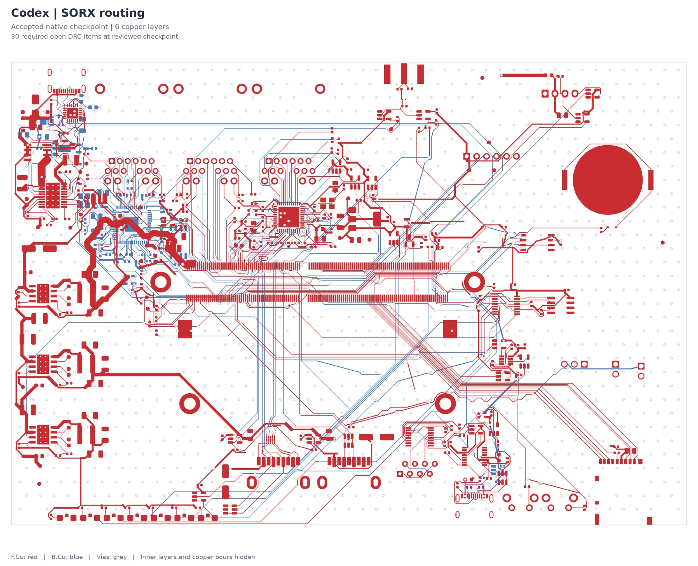
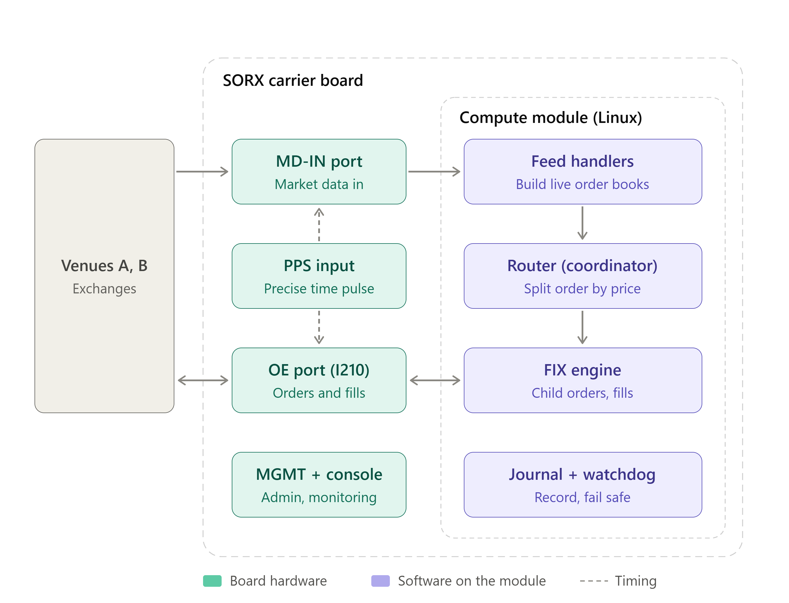

# SORX smart order router appliance

| PCB routing | Intended architecture |
|:---:|:---:|
| [](docs/images/sorx-pcb-routing.webp) | [](docs/images/sorx-order-routing.png) |
| Outer copper layers at the reviewed six-layer checkpoint. The inner layers and solid copper areas are hidden. | The carrier board provides the ports and timing signal. The Linux module runs the routing software. |

**Hardware design in progress — NOT READY FOR FABRICATION.**

In the intended appliance, market prices and available quantities arrive from trading venues through **MD-IN** (market data in). Software on the Verdin iMX8M Plus compute module builds an order book for each venue and uses those books to decide where to send a client's order. It can split the order into smaller *child orders* for different venues. Those orders go out through **OE** (order entry); confirmations of executed trades, called *fills*, come back through the same port.

## Quick start

From the MockX repository root, run these commands with Python. Neither requires Docker or KiCad:

```powershell
python examples/sorx_appliance/tools/routing_status.py
python examples/sorx_appliance/tools/routing_status.py --net OE_JTAG_PU
```

The first command checks that the board and its rules still match the saved KiCad report, then lists the remaining connections. At the reviewed checkpoint, **30 required connections are open** (16 ground, 14 other) and there are **93 other design-rule findings**. An *open* means the design calls for a connection that the copper does not complete. The second command shows the reported endpoints and any recorded decisions for just one *net*, a group of pins meant to be electrically connected.

To make a repair, start from the [editable KiCad board](hardware/hw/sorx.kicad_pcb) and follow the [one-connection routing runbook](docs/routing-runbook.md). It shows how to check that the target pins are joined and that no previously connected pins became separated.

## Design records

- [Verification results](hardware/validation/consolidation-20261118/README.md) and [release criteria](docs/release-criteria.md): what has been checked and what still blocks fabrication.
- [Routing decisions](docs/routing-ledger.json) and [independent review](docs/independent-review.md): accepted repairs, rejected attempts and the findings that motivated them.
- [Original design files](baseline/README.md), [reference image catalog](docs/image-catalog.md) and [transfer manifest](docs/local-transfer.json): where the design and comparison evidence came from.
- [Future simulation lab](docs/future-lab.md): the planned test with multiple MockX venues. The quick start above inspects hardware design files; it does not start that lab.
