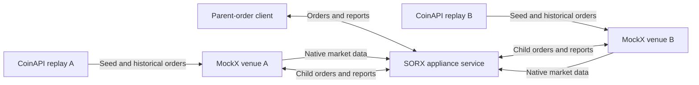

# Future SORX software integration lab

**Deferred: this bootstrap prioritizes hardware completion.** This document
describes the intended integration environment; it does not claim that the
appliance service, multi-venue coordinator or QEMU profile is implemented.

## Intended topology

The appliance consumes each venue's public market data, selects destinations,
submits ordinary FIX child orders and returns aggregated reports to its client.
Replay provides competing historical liquidity through each MockX matching
engine. The SOR must not read future capture events or privileged engine state.

## Existing components to reuse

- [C++ SOR example](../../cpp_sor/README.md) and its
  [two-venue Compose configuration](../../cpp_sor/docker-compose.yml) provide
  routing, FIX, native-feed and venue-orchestration groundwork.
- [CoinAPI replay](../../coinapi_replay/README.md) accepts local CSV/gzip
  captures and supports real external FIX orders competing with historical
  liquidity. It already documents native-feed units and recovery contracts.
- [Native market-feed client](../../cpp_market_feed/README.md) provides
  decoding, book reconstruction and GLIMPSE recovery behavior.
- Preserve the existing [SOR native smoke test](../../cpp_sor/tests/live_smoke.py)
  and [feed native smoke test](../../cpp_market_feed/tests/live_smoke.py)
  when adding the lab. They are real integration coverage despite their filenames.

Use the authoritative SorX implementation if this becomes the product's test
harness. Launch a pinned image/build rather than copy its routing engine into a
second implementation here. Keep shared MockX behavior in existing modules.

## Work required beyond Compose

The present C++ SOR processes one parent order and exits; it is not a persistent
appliance endpoint. The future service needs continuous feed/FIX sessions,
client ingress, parent/child identity and accounting, backpressure, recovery
and orderly drain. Define how client ingress uses the intended three-port
appliance's network interfaces.

The replay launcher currently owns a local exchange process and hardcodes some
loopback endpoints and FIX identities. Separate replay workers require an
explicit attach-to-existing-venue lifecycle and configurable identities, not
copied launchers with edited constants. Each connection in the SOR's QuickFIX
engine needs a distinct session identity.

Add a readiness/seeding barrier, common capture interval and pacing policy,
and coordinated stop/drain. Seed all venues before admitting parent orders.
Stop upstream submissions and settle child/report activity before ending owned
replay generations. Repeating independent realtime socket runs does not promise
identical wall-clock ordering or fills.

Align instrument units explicitly: the C++ demo uses 0.001 BTC per lot, whereas
the CoinAPI example uses 0.00000001 BTC per lot and a $0.01 tick. Configure
clients, feeds and routing consistently. Use comparable instruments and source
formats; duplicating one capture creates a synthetic two-venue test rather than
authentic independent market histories.

## Development stages and acceptance

1. **Native container lab:** two venues with small known books, a persistent SOR
   and one client. Assert exact allocations and terminal quantity accounting.
2. **Replay integration:** per-venue compatible captures, coordinated timing,
   recorded input hashes and bounded lag. Begin with the midpoint controller
   disabled; controller-enabled runs are separate scenarios.
3. **Failure scenarios:** partial fills, cancellations, stale-feed exclusion,
   packet gaps and GLIMPSE recovery, venue disconnects and restart
   reconciliation. An uncertain child execution must not be blindly resubmitted
   elsewhere and create duplicate execution.
4. **ARM profile:** build and run the same service on ARM64, optionally using a
   QEMU Linux VM. Model board-service interfaces explicitly where needed.
5. **Physical profile:** replace the simulated appliance endpoint with a
   development kit and then the custom board, retaining the venue/client harness.

Retain captures outside ordinary source control; commit only small appropriate
fixtures and scenario manifests. Record replay divergence, lag and execution
results. The existing [replay validation record](../../coinapi_replay/VALIDATION.md)
distinguishes functional success from realtime performance targets that remain
unqualified, so start with moderate workloads.

## Simulation boundaries

QEMU's [i.MX8M evaluation-kit model](https://www.qemu.org/docs/master/system/arm/imx8m.html)
does not reproduce this Verdin carrier and all its peripherals. Its
[generic Arm platform](https://www.qemu.org/docs/master/system/arm/virt.html)
can be useful for Linux/application compatibility. Neither validates KiCad
connectivity, footprints, regulator transients, physical PTP accuracy or
wire-to-wire latency. Software substitutes for watchdog, FRAM or GPIO behavior
must be labeled as such.

Keep the initial venue, replay and SOR services within one Linux container
environment. Existing relay tools address Windows-host market-data delivery;
a QEMU guest requires a deliberate network path for native multicast and
recovery traffic. Publishing TCP ports alone is insufficient.

Electrical simulation, layout review and hardware acceptance remain governed by
[the hardware release criteria](release-criteria.md), independently of whether
the software lab passes.
