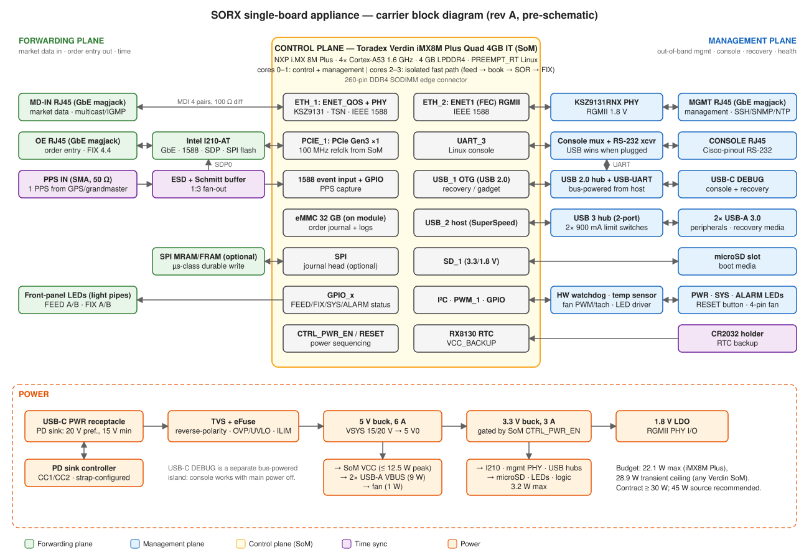

# Block diagram

Regenerate with `python3 tools/gen_block_diagram.py`.

## Plane split in hardware

| Plane | Hardware | Notes |
|---|---|---|
| Forwarding | MD-IN (SoM ETH_1, ENET_QOS + on-module KSZ9131), OE (Intel I210-AT on PCIe), PPS input, isolated cores 2–3 | Nothing else shares these two ports. Each has its own MAC, PTP clock and IRQs. |
| Control | SoM cores 0–1, eMMC journal, optional SPI MRAM/FRAM | Book state, routing decisions, FIX session state, journal. |
| Management | MGMT (SoM ETH_2, ENET1 + carrier KSZ9131RNX), RJ45 RS-232 console, USB-C debug, USB-A ×2, microSD, LEDs, watchdog, sensors, fan | Out-of-band. Console and recovery work with the forwarding ports unplugged; USB-C debug works with main power off. |

## Port to interface map

| Panel label | Connector | SoM interface | Device on carrier | Timestamping |
|---|---|---|---|---|
| MD-IN | RJ45 GbE magjack | ETH_1 MDI (ENET_QOS, TSN) | PHY is on the SoM | MAC 1588 + PPS capture pin |
| OE | RJ45 GbE magjack | PCIE_1 (Gen3 ×1) | Intel I210-AT + SPI flash | I210 PHC, PPS on SDP0, PPS out on SDP1 test point |
| MGMT | RJ45 GbE magjack | ETH_2 RGMII (ENET1) | KSZ9131RNX | MAC 1588 |
| CONSOLE | RJ45, Cisco pinout | UART_3 | RS-232 transceiver + mux | — |
| DEBUG | USB-C | UART_3 and USB_1 (OTG) | USB 2.0 hub + USB-UART bridge | — |
| USB 1, USB 2 | USB-A 3.0 | USB_2 (SuperSpeed host) | 2-port USB 3 hub + 900 mA switches | — |
| SD | microSD | SD_1 | — | — |
| PPS | SMA | 1588 event input + GPIO | ESD + Schmitt buffer, 1:3 | — |
| PWR | USB-C | — | PD sink controller, TVS, eFuse | — |

Role-to-MAC assignment rationale: the two forwarding ports get the two MACs with the best queueing and timestamping (ENET_QOS and I210); management gets the plain FEC MAC. The assignment lives in the device tree and panel silkscreen, not in the copper.

## Details worth knowing before schematics

- **Console arbitration, Cisco style.** UART_3 TX drives both the RS-232 transceiver and the USB-UART bridge. RX is muxed: USB wins when the debug cable is plugged.
- **One debug cable gives console and recovery.** The USB-C debug port feeds a 2-port USB 2.0 hub: one leg is the USB-UART bridge, the other is SoM USB_1 in device mode for Toradex recovery. The island is powered from the host, so the console is alive before the board is.
- **RESET button.** Short press resets; held through power-up it pulls `CTRL_RECOVERY_MICO#` (≤ 1 kΩ to ground at cold boot per the datasheet).
- **Watchdog is external to the SoC.** A supervisor with a programmable timeout, kicked by a SoM GPIO, pulls SoM reset and latches ALARM. A jumper disables it for bring-up.
- **ALARM fails closed.** The LED is on by default from a pull-up; software turns it off only when healthy.
- **Fan fails to full speed.** 4-pin 5 V fan header; PWM line floats high if the SoM is not driving it.
- **RTC.** On-module RX8130 backed through `VCC_BACKUP` by a CR2032 on the carrier.
- **Optional SPI MRAM/FRAM footprint.** eMMC sync writes take milliseconds, which makes journal-before-wire per order impractical on eMMC alone. A small SPI non-volatile RAM gives a microsecond-class durable write for the journal head. Proposed as a populate-option footprint; needs your decision.

## Intended panel layout (to be confirmed in placement)

- Front: LED light-pipe window (PWR, SYS, FEED A, FEED B, FIX A, FIX B, ALARM), CONSOLE RJ45, USB-C DEBUG, 2× USB-A, microSD, RESET.
- Rear: USB-C PWR, MGMT, MD-IN, OE, PPS SMA.
- Enclosure: half-width 1U, roughly 210 × 44 × 150 mm; 40 mm fan on a side wall, side-to-side airflow across the SoM heatsink.
